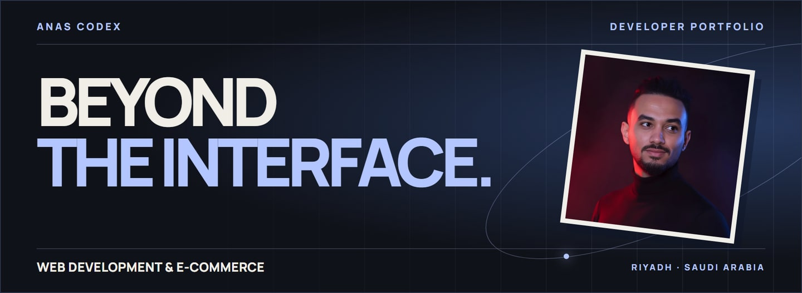

# Anas Naser Abdulelah Salam

**Web & E-Commerce Developer | React, Next.js & WordPress**

Riyadh, Saudi Arabia. Open to opportunities throughout Saudi Arabia.

[Portfolio](https://anas-codex.vercel.app/en/) | [LinkedIn](https://www.linkedin.com/in/anascodex/) | [Email](mailto:anas.coding404@gmail.com)

## What I deliver

Web and e-commerce developer with 5+ years across company roles and freelance projects. Delivered 15+ custom WordPress websites at ATEQANIA and coordinated frontend/backend delivery at NQ7GROUP. Builds Arabic/English websites and web interfaces with React, Next.js and WordPress, alongside hands-on Salla and WooCommerce product/pricing work and Shopify store ownership. Uses Claude and ChatGPT for AI-assisted coding, debugging and prototyping.

- React and Next.js web interfaces with API integrations.
- WordPress websites and WooCommerce/Salla storefront customization.
- Product information and pricing maintenance across online stores.
- Frontend/backend task allocation and technical integration coordination.

## AI-assisted development

I use Claude and ChatGPT for coding assistance, debugging and prototyping (including Vibe Coding). My personal portfolio is a practical example. My professional focus is software delivery and e-commerce; AI tool usage is not presented as production ML/LLM engineering experience.

## Selected work

### AI-assisted personal portfolio
https://anas-codex.vercel.app/en/

Built the bilingual personal website using an AI-assisted development workflow. Code profile: github.com/AnasCodex.

### Corporate and agency websites
https://kripton.sa/

Complete website development: Kripton (kripton.sa), Motion Lab (motionlab.sa), Theqa (theqa-technology.sa), Emad (emad-app.sa).

### Salla store operations
https://aleanayih-alfakhira.com/ar

Product information and pricing work. Examples: aleanayih-alfakhira.com/ar, eliana.sa/ar, pharmabrand.sa/ar. Personal Shopify store ownership began Aug 2022.

## Company career path

BlackGem Tech > Meem Graphics > NQ7GROUP > ATEQANIA. BlackGem and Meem were sequential roles. Dates below use years consistently.

### Company roles

**ATEQANIA | Senior Web Developer**  
2024 - 2026 | Remote

- Developed and launched 15+ custom WordPress websites, adapting page layouts to each client's brand and content requirements.
- Connected APIs and third-party services and collaborated with designers and marketers on implementation, maintenance and website usability.

**NQ7GROUP | Full Stack Developer**  
2022 - 2024 | Full-time | Yemen

- Coordinated frontend and backend developers: allocated tasks and followed the integration of their work.
- Coordinated handoff from the Figma design contributor into development; aligned page structure and frontend/backend implementation.

**Meem Graphics | Full Stack Developer**  
2022 | Full-time | Yemen

- Worked as a Full Stack Developer on web projects in a digital-services environment.
- Joined after leaving BlackGem Tech; subsequently moved to NQ7GROUP.

**BlackGem Tech | React Developer**  
2021 - 2022 | Full-time | Yemen

- Developed React-based web interfaces for website and software projects.
- First company role; completed before joining Meem Graphics in 2022.

### Freelance and part-time projects

**Trust & Build for Information Technology | Web Developer**  
2024 - 2026 | Freelance | Remote

- Built responsive Arabic/English websites and storefronts using WordPress and Elementor, adapting layouts and plugins to client requirements.
- Handled website maintenance, technical SEO, page-speed work, shopping-flow changes, and hosting/DNS support.

**Rising Point | Web & E-Commerce Developer**  
2025 - 2026 | Freelance | Remote

- Developed WordPress websites and customized Salla product/category pages, landing pages, forms and integrations.
- Worked on business/accounting interfaces and dashboards; resolved issues in existing projects and Arabic user flows.

**Jeetroom | Next.js Developer**  
2024 | Part-time | Remote

- Developed Next.js web application interfaces and connected APIs and external services.
- Worked on frontend functionality, performance, technical SEO and integration stability.

**NERDO for IT and Multimedia Services | Front End Developer**  
2021 - 2023 | Freelance | Remote

- Delivered freelance frontend development services for web projects alongside company employment.

Freelance and part-time projects ran alongside some company roles; overlapping periods are not added together.

## Technical focus

- **Web development:** React, Next.js, JavaScript, TypeScript, HTML5, CSS3, Tailwind CSS; responsive Arabic/English interfaces
- **CMS and commerce:** WordPress, Elementor, WooCommerce, Salla, Shopify; product data, pricing and storefront content
- **Integration and delivery:** REST API integration, Git/GitHub, technical SEO, website maintenance, hosting/DNS support; frontend/backend task coordination
- **AI-assisted workflow:** Claude, ChatGPT; coding assistance, debugging, prototyping and Vibe Coding

## Education and availability

Bachelor of Information Technology | The National University of Yemen | 2021
Arabic: Native | English: Fluent

Currently not employed. Available for interviews throughout Saudi Arabia; employment start subject to employer-sponsored work authorization.

Contact: **anas.coding404@gmail.com** | **+966 57 398 4094**
