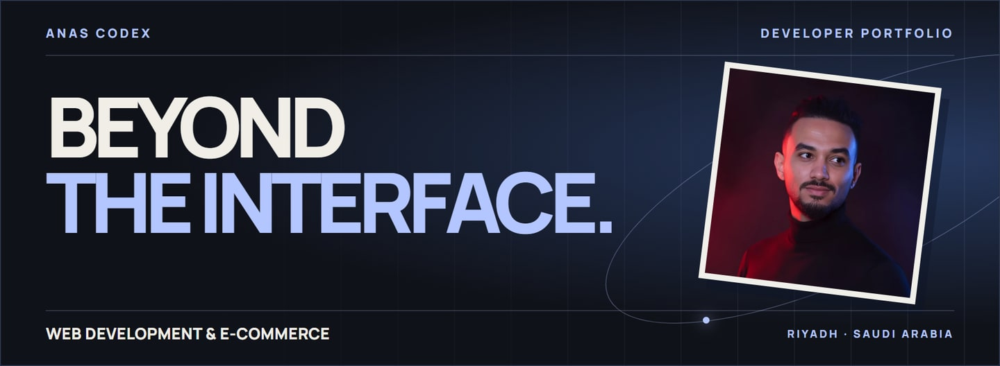
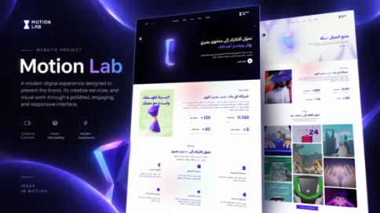
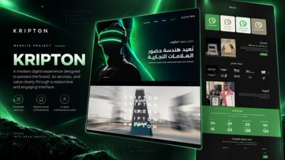
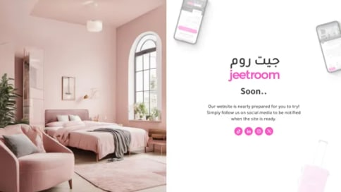

  

# Anas Naser

**Senior Web & E-Commerce Developer**  
Riyadh, Saudi Arabia · Available immediately

I develop websites, storefronts, and web applications for Arabic and English audiences. My work includes building interfaces, integrating services, and coordinating handoffs between design and engineering.

**[Explore my work](https://anas-codex.vercel.app/en/projects/)** · **[Download CV](https://anas-codex.vercel.app/resume/Anas_Naser_CV_EN.pdf)** · [السيرة بالعربية](https://anas-codex.vercel.app/resume/Anas_Naser_CV_AR.pdf) · [الموقع بالعربية](https://anas-codex.vercel.app/) · [Contact](https://anas-codex.vercel.app/en/contact/)

> **5+ years** in development &nbsp; · &nbsp; **15+ custom WordPress sites** at ATEQANIA  
> **56 projects** in the portfolio archive &nbsp; · &nbsp; **8 professional roles**

## 01 / Selected work

  
  
  

| Project | My contribution |
| :-- | :-- |
| **[Motion Lab](https://anas-codex.vercel.app/en/projects/motion-lab/)** WordPress · [Live site](https://motionlab.sa/) | Developed the complete website for a creative agency to present its work and services. |
| **[Kripton](https://anas-codex.vercel.app/en/projects/kripton/)** WordPress · [Live site](https://kripton.sa/) | Developed the complete company website using its existing brand identity. The case study includes a video walkthrough. |
| **[Jeetroom](https://anas-codex.vercel.app/en/projects/jeetroom/)** Next.js · Part-time, remote | Built web application interfaces and connected them to external services. |
| **[Theqa Technology](https://anas-codex.vercel.app/en/projects/theqa/)** [Live site](https://theqa-technology.sa/) | Developed the company website for Trust & Build for Information Technology to present its solutions and services. |
| **[Emad](https://anas-codex.vercel.app/en/projects/emad/)** [Live site](https://emad-app.sa/) | Developed the informational website introducing the platform and its services. |

[Browse the full project archive →](https://anas-codex.vercel.app/en/projects/)

## 02 / Professional experience

Some freelance and part-time engagements overlapped with company roles.

- **Trust & Build for Information Technology · Web Developer**  
  Aug 2024–Oct 2026 · Freelance, remote  
  Developed responsive Arabic and English sites and storefronts with WordPress and Elementor. Improved page speed, technical SEO, and shopping flows, provided technical support, and coordinated hosting and DNS updates.
- **Rising Point · Web & E-Commerce Developer**  
  May 2025–Aug 2026 · Freelance, remote  
  Developed WordPress sites and customized Salla storefronts, from product pages to forms and integrations. Improved Arabic dashboards and business workflows, maintained existing projects, and resolved issues.
- **ATEQANIA · Senior Web Developer**  
  Mar 2024–Jun 2026 · Remote  
  Developed and launched 15+ custom WordPress sites, integrated APIs and external services, and collaborated with designers and marketers.
- **Jeetroom · Next.js Developer**  
  Apr 2024–Oct 2024 · Part-time, remote  
  Developed dynamic Next.js applications, connected third-party services, and improved front-end performance, technical SEO, and integration stability.
- **NQ7GROUP · Full Stack Developer**  
  Oct 2022–Feb 2024 · Full-time, on-site · Sana’a, Yemen  
  Led technical coordination across front-end, back-end, and design contributors. Allocated tasks, coordinated Figma handoffs, and aligned front-end/back-end integration.
- **NERDO for IT and Multimedia Services · Front-End Developer**  
  May 2021–Jun 2023 · Freelance, remote  
  Provided front-end development services for IT and multimedia projects.
- **Meem Graphics · Full Stack Developer**  
  Jun 2022–Oct 2022 · Full-time, on-site · Sana’a, Yemen  
  Worked on full-stack development for a digital marketing and graphic design team.
- **BlackGem Tech · React Developer**  
  Nov 2021–Sep 2022 · Full-time, on-site · Sana’a, Yemen  
  Developed React interfaces for website and software projects.

[Read more about my experience](https://anas-codex.vercel.app/en/about/)

## 03 / Toolkit

| Area | Technologies |
| :-- | :-- |
| **Front-end development**  | HTML, CSS, JavaScript, React, Next.js, TypeScript, Redux, Tailwind CSS, Bootstrap 5, Sass, Material UI, jQuery, Three.js, GSAP |
| **E-commerce & CMS**  | WordPress, Salla, Zid, WooCommerce, Elementor, Shopify, Yoast SEO |
| **Back end & data**  | Node.js, Express, MongoDB, MySQL, phpMyAdmin, Firebase, JSON |
| **Developer tools**  | Git, GitHub, npm, Visual Studio Code, Chrome DevTools, Postman, Vercel, ESLint, Prettier, Vite, cPanel, Cloudflare, Hostinger, GoDaddy |
| **AI & design**  | Claude, ChatGPT, Ollama, Pinokio, Figma, Canva, Adobe Photoshop |

**How I work.** I use Claude and ChatGPT for prototyping, coding, and debugging. This portfolio is an example of that workflow. I use Canva and Photoshop for web graphics and supporting assets.

[Explore my expertise →](https://anas-codex.vercel.app/en/expertise/)

## 04 / Education & certificates

**Bachelor of Information Technology**  
The National University of Yemen, Taiz · 2021

| Certificate | Issuer |
| :-- | :-- |
| [React.js](https://maharatech.gov.eg/mod/customcert/verify_certificate.php?contextid=194868&code=8jx2ZNAsHJ&qrcode=1) | MaharaTech |
| [React + Redux](https://www.sololearn.com/certificates/CT-AHRD4LMH) | SoloLearn |
| [Responsive Web Design](https://www.sololearn.com/certificates/CT-RV66AGCH) | SoloLearn |
| [JavaScript](https://www.sololearn.com/certificates/CT-BUHMDKVK) | SoloLearn |

**Languages** · Arabic (native) · English (professional working proficiency)

## 05 / GitHub activity

  
  

  
  

<strong>Contribution calendar and streak</strong>

  

  

[View repositories](https://github.com/AnasCodex?tab=repositories) · [View contribution history](https://github.com/AnasCodex#contribution-graph)

## 06 / Contact

  <a href="mailto:anas.coding404@gmail.com">&nbsp;Email</a> &nbsp;·&nbsp;
  <a href="https://www.linkedin.com/in/anascodex">&nbsp;LinkedIn</a> &nbsp;·&nbsp;
  <a href="https://wa.me/967730110440">&nbsp;WhatsApp</a>

  <a href="https://www.instagram.com/anascodex/">&nbsp;Instagram</a> &nbsp;·&nbsp;
  <a href="https://www.youtube.com/@AnasCodex">&nbsp;YouTube</a> &nbsp;·&nbsp;
  <a href="https://github.com/AnasCodex">&nbsp;GitHub</a>

[Call +966 57 398 4094](tel:+966573984094) · [Contact form](https://anas-codex.vercel.app/en/contact/) · [التواصل بالعربية](https://anas-codex.vercel.app/contact/)
